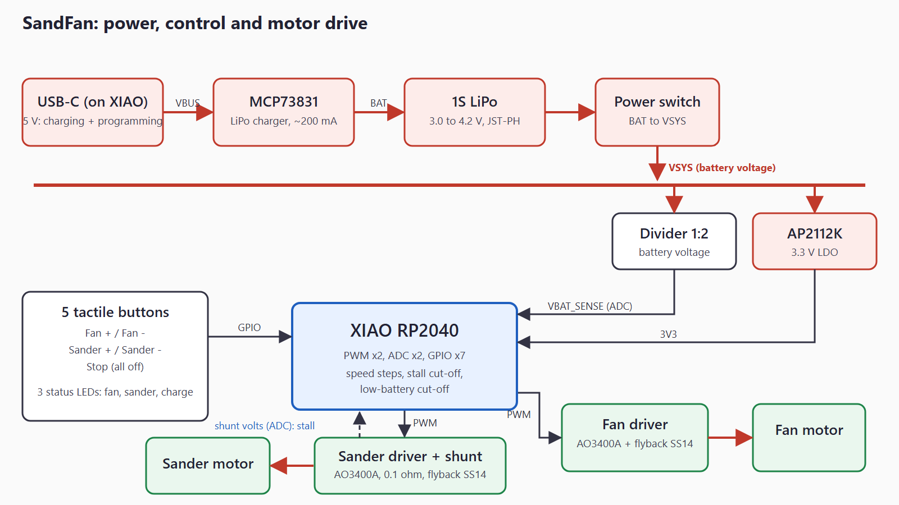

# SandFan

My project for Half-Life by Hack Club!

Meant for climbers, a two-in-one portable device:
 - Variable speed enclosed fan for drying out wet hands on one side.
 - Variable speed skin-sander for grinding down overgrown calluses.

## Schematic and board

## Bill of materials
| Part | Qty | Price | Link |
|------|-----|-------|------|
| Seeed XIAO RP2040 (plus 2x 1x7 2.54 mm headers) | 1 | TBD | TBD |
| MCP73831T-2ACI/OT charger | 1 | TBD | TBD |
| AP2112K-3.3 regulator | 1 | TBD | TBD |
| AO3400A N-MOSFET | 2 | TBD | TBD |
| SS14 Schottky diode (SMA) | 2 | TBD | TBD |
| 0.1 ohm 1% 0.5 W resistor (1206) | 1 | TBD | TBD |
| B3U-1000P tactile switch | 5 | TBD | TBD |
| OS102011MS2QN1 slide switch | 1 | TBD | TBD |
| JST-PH B2B-PH-K-S connector | 3 | TBD | TBD |
| LEDs 0603 (red, green, yellow) | 3 | TBD | TBD |
| Resistors 0603 (100, 470, 1k, 5.1k, 100k) | 12 | TBD | TBD |
| Capacitors (100 nF, 4.7 uF, 10 uF, 22 uF) | 9 | TBD | TBD |
| 1S LiPo battery, protected | 1 | TBD | TBD |
| Fan motor and sander motor | 2 | TBD | TBD |
