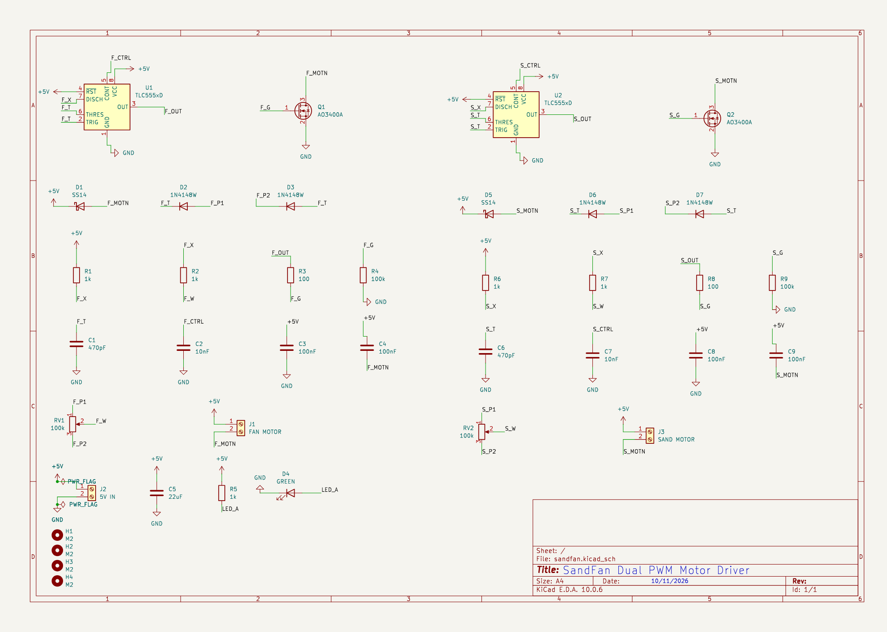
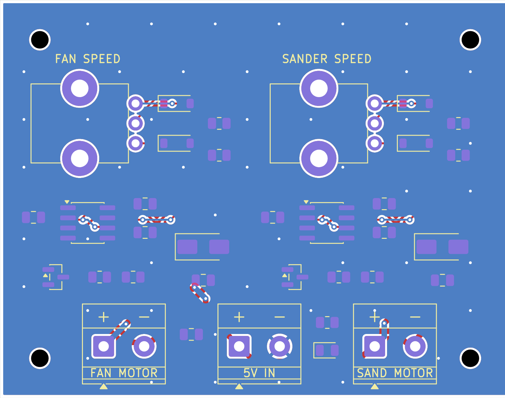
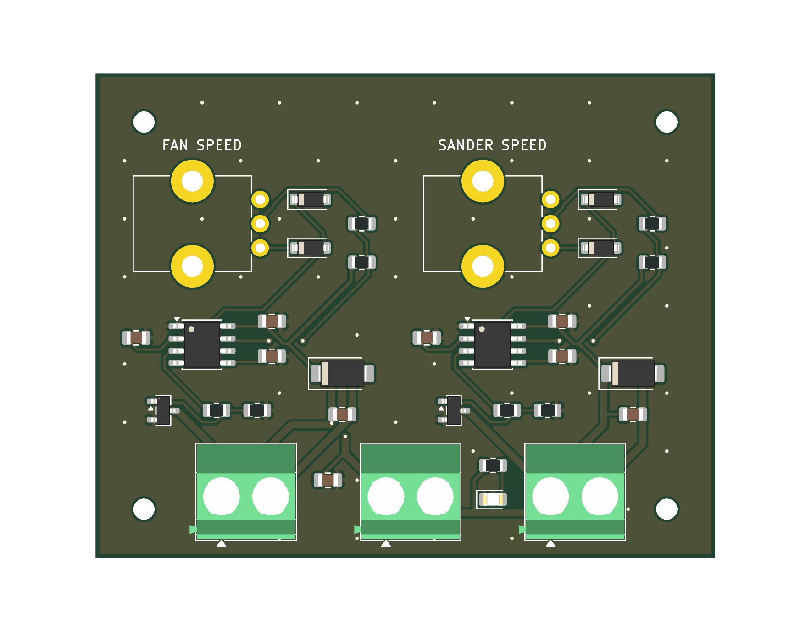

# SandFan

My project for Half-Life by Hack Club!

Meant for climbers, a two-in-one portable device:
 - Variable speed enclosed fan for drying out wet hands on one side.
 - Variable speed skin-sander for grinding down overgrown calluses.

No firmware: analog design, no microcontroller.

## Schematic and board

## Bill of materials
Designators,Qty,Value,Footprint,Description,Part number,Vendor,Est. unit price (USD),Est. line total (USD),Notes
"U1,U2",2,TLC555,SOIC-8 3.9x4.9mm,CMOS 555 timer (one per motor),TLC555CDR,Digi-Key,0.60,1.20,Digi-Key lists TLC555CD (tube) as discontinued; order the CDR reel/cut-tape part
"Q1,Q2",2,AO3400A,SOT-23,N-channel logic-level MOSFET (motor low-side switch),AO3400A,LCSC (C20917),0.10,0.20,LCSC has minimum order quantities; several clone makers list the same part
"D1,D5",2,SS14,SMA,1 A Schottky flyback diode across each motor,SS14,LCSC / Digi-Key,0.10,0.20,Rated 1 A; check stall current of the real motors
"D2,D3,D6,D7",4,1N4148W,SOD-123,Small-signal steering diode for the PWM duty network,1N4148W-7-F,Digi-Key / LCSC,0.05,0.20,
D4,1,GREEN,LED 0805,Power indicator LED,generic green 0805 LED,LCSC / Digi-Key,0.10,0.10,Pair with R5 (1k)
"RV1,RV2",2,100k,"Bourns PTV09A vertical, 9 mm",Speed pot (fan / sander),PTV09A-4020F-B104,Digi-Key / element14 / RS,1.40,2.80,CHECK: confirm the pin spacing and shaft option of this exact part number against the PTV09A-1 footprint in the datasheet before ordering
"J1,J2,J3",3,2-pos 5.08 mm screw terminal,TerminalBlock_Phoenix_MKDS-1.5-2-5.08,"Fan motor / 5V in / sander motor",MKDS 1.5/2-5.08 (1729128),Farnell / Digi-Key,1.20,3.60,Generic 5.08 mm screw terminals with the same footprint are cheaper if you do not need Phoenix
"R1,R2,R5,R6,R7",5,1k,0805,1% thick-film resistor,RC0805FR-071KL,Digi-Key / LCSC,0.02,0.10,R5 is the LED resistor
"R3,R8",2,100,0805,1% thick-film resistor (MOSFET gate),RC0805FR-07100RL,Digi-Key / LCSC,0.02,0.04,
"R4,R9",2,100k,0805,1% thick-film resistor (MOSFET gate pulldown),RC0805FR-07100KL,Digi-Key / LCSC,0.02,0.04,
"C1,C6",2,470pF,0805,C0G/NP0 50 V timing capacitor,generic 0805 C0G 470pF 50V,Digi-Key / LCSC,0.03,0.06,Use C0G for timing stability
"C2,C7",2,10nF,0805,X7R 50 V 555 control-pin capacitor,generic 0805 X7R 10nF 50V,Digi-Key / LCSC,0.02,0.04,
"C3,C4,C8,C9",4,100nF,0805,X7R 50 V decoupling / motor capacitor,generic 0805 X7R 100nF 50V,Digi-Key / LCSC,0.02,0.08,
C5,1,22uF,0805,X5R 16 V bulk capacitor on the 5V input,generic 0805 X5R 22uF 16V,Digi-Key / LCSC,0.15,0.15,A 10 V part is marginal on a 5 V rail; use 16 V
,,,,,,,Est. parts subtotal,8.81,Unit prices are estimates rounded from distributor listings I could find; none are live quotes. Excludes tax and shipping. Confirm each price at checkout.

